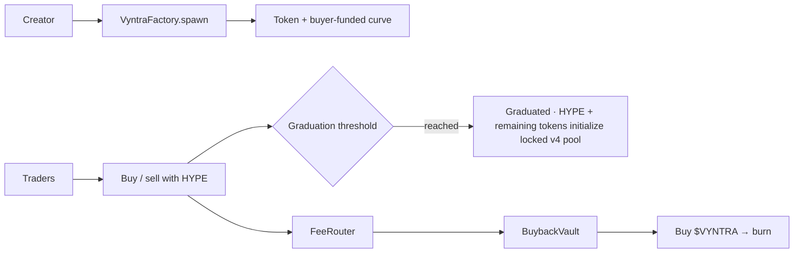

<!--
        ██╗   ██╗██╗   ██╗███╗   ██╗████████╗██████╗  █████╗
        ██║   ██║╚██╗ ██╔╝████╗  ██║╚══██╔══╝██╔══██╗██╔══██╗
        ██║   ██║ ╚████╔╝ ██╔██╗ ██║   ██║   ██████╔╝███████║
        ╚██╗ ██╔╝  ╚██╔╝  ██║╚██╗██║   ██║   ██╔══██╗██╔══██║
         ╚████╔╝    ██║   ██║ ╚████║   ██║   ██║  ██║██║  ██║
          ╚═══╝     ╚═╝   ╚═╝  ╚═══╝   ╚═╝   ╚═╝  ╚═╝╚═╝  ╚═╝

        Permissionless memecoin launches on Elysium Testnet.
        Public product overview belongs here.
-->

<div align="center">

**[Markets](#-how-a-launch-works)** ·
**[Fees](#-fee-model)** ·
**[Platform token](#-vyntra--platform-token)** ·
**[Architecture](#-architecture)** ·
**[Quickstart](#-quickstart)** ·
**[Docs](#-documentation)**

<br/>

[](https://explorer-elysium-testnet.t.conduit.xyz)
[](./src)
[](./frontend)
[](./indexer)
[](./LICENSE)

</div>

<br/>

> **Vyntra is a permissionless launchpad on Elysium Testnet.** Creators launch with no HYPE liquidity deposit or platform launch fee. Buyers trade against a published HYPE curve; at graduation, the remaining token allocation and raised HYPE initialize a no-hook Uniswap v4 pool with a permanently locked Vyntra position. Protocol revenue supports `$VYNTRA` buybacks.

Each 1 billion token supply is split into a 60% curve sale and 40% pool allocation. The linear curve starts at one third of the terminal pool price; buyer HYPE builds the graduation reserve. The first three blocks cap aggregate buys at 2% of token supply. A creator can optionally include an opening buy, but creation itself requires only network gas.

---

## ◈ Why Vyntra exists

Most launchpads either abandon traders after graduation or skim fees with no clear sink. Creators need durable revenue. Traders need continuous markets. The protocol needs a transparent way to absorb volume.

Vyntra answers:

- Can anyone launch with required image, description, and a unique ticker?
- Does a curve graduate automatically into a permanently locked liquidity pool?
- Can the locked liquidity position be withdrawn by an owner or admin?
- Do creators earn a clear share of collected pool fees?
- Does protocol revenue strengthen a fixed-supply platform token?



---

## ⬡ How a launch works

```text
Creator uploads image + metadata and pays network gas
        │
        ▼
 VyntraFactory.spawn()
  · mints VyntraToken (1B fixed)
  · deploys VyntraCurve market adapter
  · assigns 600M tokens to the curve and 400M to graduation liquidity
  · opens trading without a creator-supplied HYPE reserve
        │
        ▼
 Traders buy/sell with HYPE on the curve
  · 1% fee shared by creator and protocol
  · aggregate first-three-block buys capped at 2% of supply
        │
        ▼
 Net HYPE buys ≥ graduation threshold
        │
        ▼
 Graduated · curve reserve + 400M pool allocation initialize V4
  · transition occurs atomically with the final curve buy
  · Vyntra's full-range V4 position has no removal or transfer function
```

### Recognizable token addresses

The factory deploys every launch token with CREATE2 and requires the address to end in `7f7`. The launch page finds a matching salt before asking the wallet to sign, and the factory rejects any salt that would produce a different suffix.

### Pool launch

Each launch starts on a linear HYPE bonding curve calibrated to raise the configured net-HYPE graduation target across its 600M-token sale allocation. Its starting price is one third of the terminal pool price. The remaining 400M tokens are held for graduation. When the curve sells its allocation and reaches the target, the market initializes a no-hook Uniswap v4 pool using the collected HYPE and reserved tokens; its full-range position cannot be withdrawn.

### Graduation

The final curve buy triggers graduation and pool initialization in one transaction. If initialization fails, that buy reverts. Trading then uses the newly initialized V4 pool. This automatic transition avoids a separate manual migration transaction, but it remains custom contract logic that needs review and testing.

### Launch requirements

- Image (upload or URL) and description — empty values revert on-chain
- Unique name and unique symbol (case-insensitive)
- No creator liquidity deposit or platform launch fee
- Wallet on Elysium Testnet with HYPE for network gas
- Optional HYPE opening buy, if the creator chooses to buy their own token

---

## ◎ Fee model

Curve buys and sells pay a **1% trade fee**. After graduation, swaps pay the pool's fixed **1% Uniswap v4 fee**. Curve fees are split equally; V4 fees accrue to the locked position and are split when collected:

```text
HYPE-denominated LP fees
 ├── 50% → creator (claimable)
 └── 50% → protocol treasury (VyntraFeeRouter)
             ├── 80% → VyntraBuybackVault → buy VYNTRA → burn
             └── 20% → ops treasury
```

Token-denominated LP fees are sent to the creator when the position fees are collected. Launches have no creator transfer tax.

---

## ◆ `$VYNTRA` — platform token

| | |
| --- | --- |
| Name | Vyntra |
| Ticker | **VYNTRA** |
| Supply | **1,000,000,000** fixed |
| Role | Buyback sink for protocol revenue |

Deploy opens a buyer-funded HYPE/VYNTRA market. Buyers trade against a 30 million VYNTRA curve allocation; the remaining 20 million market allocation joins the raised HYPE in the locked V4 pool at graduation. The deployer supplies no HYPE seed. As meme volume grows, protocol fees push HYPE into that market, buy VYNTRA, and send it to the burn address.

The deployment allocates 50 million VYNTRA (5%) to its market (30M curve sale, 20M locked pool allocation at graduation) and places the remaining 950 million in a policy vault: 190M community and creator incentives, 142.5M ecosystem grants, and 617.5M unallocated. The treasury Safe proposes reserve actions through a 30-day timelock. Disclosed campaigns share a 50M VYNTRA rolling 365-day release cap; unclaimed tokens return to their original budget without restoring cap capacity. Protocol buybacks are limited to 0.5% of market HYPE reserves per transaction and at least six hours apart. Creators can also spend VYNTRA on labeled featured placement; those fees are sent to the burn address.

**Intended flywheel:** more launches and volume can create more protocol revenue, paced buybacks, and token burns. This depends on actual usage; it does not guarantee token demand or price appreciation.

---

## ✓ Product surface

| Surface | What you get |
| --- | --- |
| Markets | Live feed with pool progress, graduation state, and labeled featured placements |
| Launch | Image upload, metadata, uniqueness checks, no required liquidity deposit or platform launch fee |
| Token | Chart, buy/sell, trade tape, holders, snipers, replies, share |
| Studio | Creator launches, pool-fee claims, keeper sweep |
| Portfolio | Wallet positions, average-cost PnL, trade history |
| Indexer | Launches, trades, OHLCV, holders, snipers, portfolio API |

---

## ⛩ Architecture

| Contract | Role |
| --- | --- |
| `VyntraFactory` | Enforces metadata, uniqueness, graduation threshold, and vanity suffix; coordinates curve launches |
| `VyntraMarketDeployer` | Factory-bound helper that deploys launch market adapters to keep factory bytecode deployable |
| `VyntraToken` | Fixed-supply ERC-20 with image and description |
| `PoolManager` | Vyntra-owned deployment of Uniswap v4 core with protocol-fee governance renounced |
| `VyntraCurve` | Linear buyer-funded curve, automatic V4 graduation, fees, early-buy cap, permanent position custody |
| `VYNTRA` | Platform ERC-20 |
| `VyntraMarket` | Buyer-funded VYNTRA curve that graduates into a no-hook V4 pool with locked liquidity |
| `VyntraReserveTimelock` | 30-day public delay; sole proposer is the treasury Safe |
| `VyntraReserveVault` | Holds the 950M reserve, tracks allocations, and enforces campaign release limits |
| `VyntraPromotion` | Creator-paid featured placement, with VYNTRA sent to burn address |
| `VyntraFeeRouter` | 80% vault / 20% ops |
| `VyntraBuybackVault` | Capped, rate-limited buy-and-burn |
| `VyntraKeeper` | Batched claim → distribute → buyback helpers |
| `VyntraBoard` | On-chain replies per launch |

Fairness defaults:

- No team allocation; the 950M reserve starts in a policy vault split 20% incentives, 15% grants, and 65% unallocated
- Reserve campaigns require public disclosure, a 30-day timelock, and share a 50M VYNTRA rolling 365-day cap
- V4 pool initialization and liquidity addition happen atomically in the graduation buy; there is no public uninitialized-pool window
- The first three blocks have a global 2% supply buy cap, not a per-wallet allowance
- The market adapter has no function that can reduce or transfer its liquidity position
- Other users may add and withdraw separate positions from the public v4 pool; only Vyntra's position is locked
- No custom hook is installed; the final curve buy performs the automatic curve-to-V4 transition
- The curve price schedule and initial-buy cap reduce launch-price discretion and early concentration; neither prevents later price movement or guarantees pool depth
- External positions may change initialized ticks, making app quotes approximate; minimum-output limits protect each submitted trade
- Duplicate names and tickers revert

---

## ◇ Networks

| Network | Chain ID | Explorer |
| --- | --- | --- |
| Elysium Testnet | 99801 | [Elysium Testnet Explorer](https://explorer-elysium-testnet.t.conduit.xyz) |

---

## 🗺 Repository map

```text
Vyntra/
├─ src/          Foundry contracts
├─ script/       Deploy and finish-deploy scripts
├─ test/         Forge tests
├─ frontend/     React + Vite + wagmi app
├─ indexer/      SQLite event indexer + HTTP API
├─ docs/         Economics and deploy notes
└─ SECURITY.md   Threat model and hardening notes
```

---

## ⚡ Quickstart

### Prerequisites

- Node.js 20 or newer (nvm recommended)
- Foundry
- Elysium Testnet RPC access

### Contracts

```bash
forge install
forge install Uniswap/v4-core@v1.0.2
forge build --skip test
```

### Frontend

```bash
cd frontend
cp .env.example .env
# set VITE_FACTORY_ADDRESS and related addresses after deploy
npm install
npm run dev
```

### Indexer

```bash
cd indexer
cp .env.example .env
# set FACTORY_ADDRESS after deploy (API serves empty data until then)
npm install
npm run dev          # API :8787 + sync loop
```

Point the frontend at the indexer:

```env
VITE_INDEXER_URL=http://127.0.0.1:8787
```

---

## ✓ Verification

```bash
forge test

cd frontend && npm run build

cd ../indexer && npm run typecheck
```

---

## 📚 Documentation

| Read this | Use it for |
| --- | --- |
| [`docs/ECONOMICS.md`](docs/ECONOMICS.md) | Fee splits, `$VYNTRA` flywheel, launch rules |
| [`VYNTRA_TOKENOMICS.md`](VYNTRA_TOKENOMICS.md) | Supply allocation, reserve control, buyback limits, and platform-token utility |
| [`ELYSIUM_TESTNET_DEPLOYMENT.md`](ELYSIUM_TESTNET_DEPLOYMENT.md) | Testnet deployment, pool design, launch protections |
| [`SECURITY.md`](SECURITY.md) | Threat model and hardening checklist |
| [`indexer/README.md`](indexer/README.md) | Indexer API and local run |

---

## 🛡 Security

Report suspected vulnerabilities privately to the repository owner. Do not publish exploit details in a public issue.

See [`SECURITY.md`](SECURITY.md) for the current threat model and controls.

---

## License

MIT

<br/>

<div align="center">

**Fair launches · Locked venues · `$VYNTRA` burn**

<sub>Permissionless memecoin launches on Elysium Testnet.</sub>

</div>
