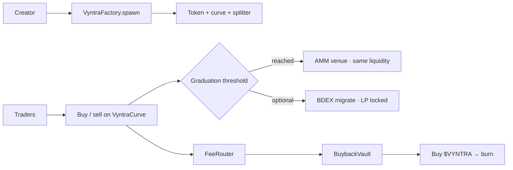

<!--
        ██╗   ██╗██╗   ██╗███╗   ██╗████████╗██████╗  █████╗
        ██║   ██║╚██╗ ██╔╝████╗  ██║╚══██╔══╝██╔══██╗██╔══██╗
        ██║   ██║ ╚████╔╝ ██╔██╗ ██║   ██║   ██████╔╝███████║
        ╚██╗ ██╔╝  ╚██╔╝  ██║╚██╗██║   ██║   ██╔══██╗██╔══██║
         ╚████╔╝    ██║   ██║ ╚████║   ██║   ██║  ██║██║  ██║
          ╚═══╝     ╚═╝   ╚═╝  ╚═══╝   ╚═╝   ╚═╝  ╚═╝╚═╝  ╚═╝

        Permissionless memecoin launches on BOT Chain.
        Public product overview belongs here.
-->

<div align="center">

**[Markets](#-how-a-launch-works)** ·
**[Fees](#-fee-model)** ·
**[Platform token](#-vyntra--platform-token)** ·
**[Architecture](#-architecture)** ·
**[Quickstart](#-quickstart)** ·
**[Docs](#-documentation)**

<br/>

[](https://scan.bohr.life)
[](./src)
[](./frontend)
[](./indexer)
[](./LICENSE)

</div>

<br/>

> **Vyntra is a permissionless memecoin launchpad on BOT Chain.** Creators launch with on-chain metadata, traders discover and buy on a bonding curve that stays open after graduation, and protocol fees buy and burn `$VYNTRA`.

Vyntra keeps the full launch lifecycle on one venue: fair curve discovery, locked post-grad trading, optional creator tax, creator fee claims, BDEX migration when configured, and a fixed-supply platform token as the protocol sink.

---

## ◈ Why Vyntra exists

Most launchpads either abandon traders after graduation or skim fees with no clear sink. Creators need durable revenue. Traders need continuous markets. The protocol needs a transparent way to absorb volume.

Vyntra answers:

- Can anyone launch with required image, description, and a unique ticker?
- Do buys and sells stay open after the graduation milestone?
- Do creators earn a clear share of every trade?
- Can creators optionally add a buy/sell tax with an explicit split?
- Does protocol revenue strengthen a fixed-supply platform token?



---

## ⬡ How a launch works

```text
Creator uploads image + metadata (+ optional tax)
        │
        ▼
 VyntraFactory.spawn()
  · mints VyntraToken (1B fixed)
  · deploys VyntraRevenueSplitter
  · deploys VyntraCurve
  · 800M tokens for sale on the curve
        │
        ▼
 Traders buy/sell with BOT
  · 1.25% protocol fee
  · optional creator tax → splitter
  · anti-snipe on the first blocks
        │
        ▼
 Real BOT raised ≥ graduation threshold
        │
        ▼
 Graduated · AMM live
  · same locked liquidity stays tradeable
  · optional BDEX migration when a router is configured
```

### Bonding phase

Each launch seeds a constant-product curve with virtual and real reserves. **800M** of the 1B supply sells through the curve. Progress is `realBotReserves / graduationThreshold`.

### Graduation

When raised BOT hits the threshold, the curve marks graduated. Liquidity stays in the venue. Traders keep using the same market; the UI labels the venue as AMM.

### Launch requirements

- Image (upload or URL) and description — empty values revert on-chain
- Unique name and unique symbol (case-insensitive)
- Optional creator tax: off, or 1–10% buy/sell with a 4-way split totaling 100%
- Wallet on BOT Chain with gas

---

## ◎ Fee model

Every buy and sell pays **1.25%** in BOT:

```text
1.25% trade fee
 ├── 50%  → creator (claimable)
 ├── 10%  → referrer, when set on the buy
 └── ~40% → protocol treasury (VyntraFeeRouter)
              ├── 80% → VyntraBuybackVault → buy VYNTRA → burn
              └── 20% → ops treasury
```

After the protocol fee, an optional **creator tax** (0 or 1–10% buy/sell) can route to `VyntraRevenueSplitter`:

```text
creator tax BOT
 ├── funds       → claimFunds
 ├── buyback     → buyAndBurnMeme
 ├── dividends   → claimDividends
 └── liquidity   → injectLiquidity
```

Default preset when tax is enabled: **5% / 5%** buy/sell with a **40 / 20 / 20 / 20** split.

Worked example on **1 BOT** of volume (protocol fee only):

| Slice | Amount | Recipient |
| --- | --- | --- |
| Creator | 0.00625 BOT | Token creator |
| Referrer | 0.00125 BOT | Optional |
| Protocol | 0.005 BOT | 0.004 buyback + 0.001 ops |

---

## ◆ `$VYNTRA` — platform token

| | |
| --- | --- |
| Name | Vyntra |
| Ticker | **VYNTRA** |
| Supply | **1,000,000,000** fixed |
| Role | Buyback sink for protocol revenue |

Deploy seeds a BOT/VYNTRA market. As meme volume grows, protocol fees push BOT into that market, buy VYNTRA, and send it to the burn address.

**Flywheel:** more launches and volume → more protocol BOT → more VYNTRA burned → scarcer float.

---

## ✓ Product surface

| Surface | What you get |
| --- | --- |
| Markets | Live feed with bonding progress and graduation state |
| Launch | Image upload, metadata, uniqueness checks, optional tax |
| Token | Chart, buy/sell, trade tape, holders, snipers, replies, share |
| Studio | Creator launches, fee claims, tax bucket actions, keeper sweep |
| Portfolio | Wallet positions, average-cost PnL, trade history |
| Indexer | Launches, trades, OHLCV, holders, snipers, portfolio API |

---

## ⛩ Architecture

| Contract | Role |
| --- | --- |
| `VyntraFactory` | Creates token, splitter, and curve; enforces metadata and uniqueness |
| `VyntraToken` | Fixed-supply ERC-20 with image and description |
| `VyntraCurve` | Buy/sell, fees, tax, anti-snipe, graduation, optional BDEX migrate |
| `VyntraRevenueSplitter` | Per-launch tax → funds / buyback / dividends / liquidity |
| `VYNTRA` | Platform ERC-20 |
| `VyntraMarket` | BOT/VYNTRA pool for buybacks |
| `VyntraFeeRouter` | 80% vault / 20% ops |
| `VyntraBuybackVault` | Permissionless buy-and-burn |
| `VyntraKeeper` | Batched claim → distribute → buyback helpers |
| `VyntraBoard` | On-chain replies per launch |

Fairness defaults:

- No bonding-curve team allocation on the meme
- Launch-block creator-only buys; next three blocks capped at 2% supply per buy
- Bonding inventory stays locked in the curve / AMM
- Duplicate names and tickers revert

---

## ◇ Networks

| Network | Chain ID | Explorer |
| --- | --- | --- |
| BOT testnet | 968 | [scan.bohr.life](https://scan.bohr.life) |
| BOT mainnet | 677 | [scan.botchain.ai](https://scan.botchain.ai) |

---

## 🗺 Repository map

```text
Vyntra/
├─ src/          Foundry contracts
├─ script/       Deploy and finish-deploy scripts
├─ test/         Forge tests
├─ frontend/     React + Vite + wagmi app
├─ indexer/      SQLite event indexer + HTTP API
├─ docs/         Economics and deploy notes
└─ SECURITY.md   Threat model and hardening notes
```

---

## ⚡ Quickstart

### Prerequisites

- Node.js 20 or newer (nvm recommended)
- Foundry
- BOT Chain RPC access

### Contracts

```bash
forge install
forge test
```

### Frontend

```bash
cd frontend
cp .env.example .env
# set VITE_FACTORY_ADDRESS and related addresses after deploy
npm install
npm run dev
```

### Indexer

```bash
cd indexer
cp .env.example .env
# set FACTORY_ADDRESS after deploy (API serves empty data until then)
npm install
npm run dev          # API :8787 + sync loop
```

Point the frontend at the indexer:

```env
VITE_INDEXER_URL=http://127.0.0.1:8787
```

---

## ✓ Verification

```bash
forge test

cd frontend && npm run build

cd ../indexer && npm run typecheck
```

---

## 📚 Documentation

| Read this | Use it for |
| --- | --- |
| [`docs/ECONOMICS.md`](docs/ECONOMICS.md) | Fee splits, `$VYNTRA` flywheel, launch rules |
| [`docs/DEPLOY.md`](docs/DEPLOY.md) | Broadcast order, seeds, env cutover |
| [`SECURITY.md`](SECURITY.md) | Threat model and hardening checklist |
| [`indexer/README.md`](indexer/README.md) | Indexer API and local run |

---

## 🛡 Security

Report suspected vulnerabilities privately to the repository owner. Do not publish exploit details in a public issue.

See [`SECURITY.md`](SECURITY.md) for the current threat model and controls.

---

## License

MIT

<br/>

<div align="center">

**Fair launches · Locked venues · `$VYNTRA` burn**

<sub>Permissionless memecoin launches on BOT Chain.</sub>

</div>
