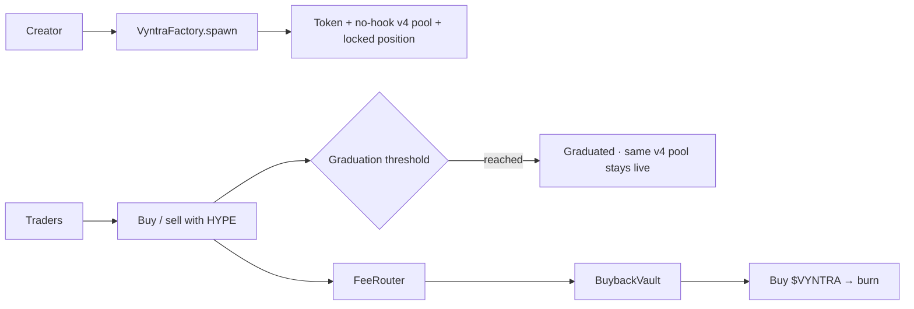

<!--
        ██╗   ██╗██╗   ██╗███╗   ██╗████████╗██████╗  █████╗
        ██║   ██║╚██╗ ██╔╝████╗  ██║╚══██╔══╝██╔══██╗██╔══██╗
        ██║   ██║ ╚████╔╝ ██╔██╗ ██║   ██║   ██████╔╝███████║
        ╚██╗ ██╔╝  ╚██╔╝  ██║╚██╗██║   ██║   ██╔══██╗██╔══██║
         ╚████╔╝    ██║   ██║ ╚████║   ██║   ██║  ██║██║  ██║
          ╚═══╝     ╚═╝   ╚═╝  ╚═══╝   ╚═╝   ╚═╝  ╚═╝╚═╝  ╚═╝

        Permissionless memecoin launches on Elysium Testnet.
        Public product overview belongs here.
-->

<div align="center">

**[Markets](#-how-a-launch-works)** ·
**[Fees](#-fee-model)** ·
**[Platform token](#-vyntra--platform-token)** ·
**[Architecture](#-architecture)** ·
**[Quickstart](#-quickstart)** ·
**[Docs](#-documentation)**

<br/>

[](https://explorer-elysium-testnet.t.conduit.xyz)
[](./src)
[](./frontend)
[](./indexer)
[](./LICENSE)

</div>

<br/>

> **Vyntra is a permissionless launchpad on Elysium Testnet.** Each token launches directly into a HYPE-paired Uniswap v4 pool. The pool uses no custom hook, its full-range liquidity position cannot be withdrawn, and graduation records progress without moving liquidity. Protocol revenue supports `$VYNTRA` buybacks.

The factory creates each token, initializes its pool, and deposits the full token supply plus the creator's HYPE seed in one transaction. The opening price is derived from those amounts. Seeds are bounded to 5–100 HYPE, and aggregate buys during the first three blocks cannot exceed 2% of token supply.

---

## ◈ Why Vyntra exists

Most launchpads either abandon traders after graduation or skim fees with no clear sink. Creators need durable revenue. Traders need continuous markets. The protocol needs a transparent way to absorb volume.

Vyntra answers:

- Can anyone launch with required image, description, and a unique ticker?
- Does the same pool keep trading after the graduation milestone?
- Can the locked liquidity position be withdrawn by an owner or admin?
- Do creators earn a clear share of collected pool fees?
- Does protocol revenue strengthen a fixed-supply platform token?



---

## ⬡ How a launch works

```text
Creator uploads image + metadata and chooses a 5–100 HYPE seed
        │
        ▼
 VyntraFactory.spawn()
  · mints VyntraToken (1B fixed)
  · deploys VyntraCurve market adapter
  · initializes a no-hook Uniswap v4 HYPE pool
  · deposits all 1B tokens and the HYPE seed atomically
        │
        ▼
 Traders buy/sell with HYPE
  · 1% Uniswap v4 pool fee
  · aggregate first-three-block buys capped at 2% of supply
        │
        ▼
 Net HYPE buys ≥ graduation threshold
        │
        ▼
 Graduated · the same v4 pool stays open
  · graduation does not move liquidity or change the trading venue
  · the market contract has no liquidity-removal or position-transfer function
```

### Recognizable token addresses

The factory deploys every launch token with CREATE2 and requires the address to end in `7f7`. The launch page finds a matching salt before asking the wallet to sign, and the factory rejects any salt that would produce a different suffix.

### Pool launch

Each launch creates a no-hook Uniswap v4 pool paired with native HYPE. The full-range position is owned by the market adapter and is initialized in the same transaction as the token. The starting price follows the fixed token supply and selected HYPE seed; the factory enforces the 5–100 HYPE bounds and the launch form shows the required seed before signing.

### Graduation

When net HYPE buys reach the configured threshold, the market marks graduated. Trading continues in that same pool; there is no curve-to-pool migration.

### Launch requirements

- Image (upload or URL) and description — empty values revert on-chain
- Unique name and unique symbol (case-insensitive)
- Initial locked liquidity: 5–100 HYPE
- Wallet on Elysium Testnet with gas

---

## ◎ Fee model

Every swap pays the pool's fixed **1% Uniswap v4 fee**. Uniswap v4 accrues fees to the locked position. When collected:

```text
HYPE-denominated LP fees
 ├── 50% → creator (claimable)
 └── 50% → protocol treasury (VyntraFeeRouter)
             ├── 80% → VyntraBuybackVault → buy VYNTRA → burn
             └── 20% → ops treasury
```

Token-denominated LP fees are sent to the creator when the position fees are collected. Launches have no creator transfer tax.

---

## ◆ `$VYNTRA` — platform token

| | |
| --- | --- |
| Name | Vyntra |
| Ticker | **VYNTRA** |
| Supply | **1,000,000,000** fixed |
| Role | Buyback sink for protocol revenue |

Deploy seeds a HYPE/VYNTRA market. As meme volume grows, protocol fees push HYPE into that market, buy VYNTRA, and send it to the burn address.

The deployment seeds 50 million VYNTRA (5%) into the market and places the remaining 950 million in a policy vault: 190M community and creator incentives, 142.5M ecosystem grants, and 617.5M unallocated. The treasury Safe proposes reserve actions through a 30-day timelock. Disclosed campaigns share a 50M VYNTRA rolling 365-day release cap; unclaimed tokens return to their original budget without restoring cap capacity. Protocol buybacks are limited to 0.5% of market HYPE reserves per transaction and at least six hours apart. Creators can also spend VYNTRA on labeled featured placement; those fees are sent to the burn address.

**Intended flywheel:** more launches and volume can create more protocol revenue, paced buybacks, and token burns. This depends on actual usage; it does not guarantee token demand or price appreciation.

---

## ✓ Product surface

| Surface | What you get |
| --- | --- |
| Markets | Live feed with pool progress, graduation state, and labeled featured placements |
| Launch | Image upload, metadata, uniqueness checks, 5–100 HYPE seed |
| Token | Chart, buy/sell, trade tape, holders, snipers, replies, share |
| Studio | Creator launches, pool-fee claims, keeper sweep |
| Portfolio | Wallet positions, average-cost PnL, trade history |
| Indexer | Launches, trades, OHLCV, holders, snipers, portfolio API |

---

## ⛩ Architecture

| Contract | Role |
| --- | --- |
| `VyntraFactory` | Enforces metadata, uniqueness, seed bounds, and vanity suffix; coordinates atomic launches |
| `VyntraMarketDeployer` | Factory-bound helper that deploys launch market adapters to keep factory bytecode deployable |
| `VyntraToken` | Fixed-supply ERC-20 with image and description |
| `PoolManager` | Vyntra-owned deployment of Uniswap v4 core with protocol-fee governance renounced |
| `VyntraCurve` | No-hook v4 swaps, fee collection, early-buy cap, graduation status, permanent position custody |
| `VYNTRA` | Platform ERC-20 |
| `VyntraMarket` | No-hook v4 HYPE/VYNTRA pool with locked seed liquidity |
| `VyntraReserveTimelock` | 30-day public delay; sole proposer is the treasury Safe |
| `VyntraReserveVault` | Holds the 950M reserve, tracks allocations, and enforces campaign release limits |
| `VyntraPromotion` | Creator-paid featured placement, with VYNTRA sent to burn address |
| `VyntraFeeRouter` | 80% vault / 20% ops |
| `VyntraBuybackVault` | Capped, rate-limited buy-and-burn |
| `VyntraKeeper` | Batched claim → distribute → buyback helpers |
| `VyntraBoard` | On-chain replies per launch |

Fairness defaults:

- No team allocation; the 950M reserve starts in a policy vault split 20% incentives, 15% grants, and 65% unallocated
- Reserve campaigns require public disclosure, a 30-day timelock, and share a 50M VYNTRA rolling 365-day cap
- Pool initialization and seeding happen atomically; there is no public uninitialized-pool window
- The first three blocks have a global 2% supply buy cap, not a per-wallet allowance
- The market adapter has no function that can reduce or transfer its liquidity position
- Other users may add and withdraw separate positions from the public v4 pool; only Vyntra's seed position is locked
- No custom hook is installed; graduation never triggers a migration
- The 5 HYPE minimum seed improves launch depth, but later trades can still move price or reduce one side of pool inventory
- External positions may change initialized ticks, making app quotes approximate; minimum-output limits protect each submitted trade
- Duplicate names and tickers revert

---

## ◇ Networks

| Network | Chain ID | Explorer |
| --- | --- | --- |
| Elysium Testnet | 99801 | [Elysium Testnet Explorer](https://explorer-elysium-testnet.t.conduit.xyz) |

---

## 🗺 Repository map

```text
Vyntra/
├─ src/          Foundry contracts
├─ script/       Deploy and finish-deploy scripts
├─ test/         Forge tests
├─ frontend/     React + Vite + wagmi app
├─ indexer/      SQLite event indexer + HTTP API
├─ docs/         Economics and deploy notes
└─ SECURITY.md   Threat model and hardening notes
```

---

## ⚡ Quickstart

### Prerequisites

- Node.js 20 or newer (nvm recommended)
- Foundry
- Elysium Testnet RPC access

### Contracts

```bash
forge install
forge install Uniswap/v4-core@v1.0.2
forge build --skip test
```

### Frontend

```bash
cd frontend
cp .env.example .env
# set VITE_FACTORY_ADDRESS and related addresses after deploy
npm install
npm run dev
```

### Indexer

```bash
cd indexer
cp .env.example .env
# set FACTORY_ADDRESS after deploy (API serves empty data until then)
npm install
npm run dev          # API :8787 + sync loop
```

Point the frontend at the indexer:

```env
VITE_INDEXER_URL=http://127.0.0.1:8787
```

---

## ✓ Verification

```bash
forge test

cd frontend && npm run build

cd ../indexer && npm run typecheck
```

---

## 📚 Documentation

| Read this | Use it for |
| --- | --- |
| [`docs/ECONOMICS.md`](docs/ECONOMICS.md) | Fee splits, `$VYNTRA` flywheel, launch rules |
| [`VYNTRA_TOKENOMICS.md`](VYNTRA_TOKENOMICS.md) | Supply allocation, reserve control, buyback limits, and platform-token utility |
| [`ELYSIUM_TESTNET_DEPLOYMENT.md`](ELYSIUM_TESTNET_DEPLOYMENT.md) | Testnet deployment, pool design, launch protections |
| [`SECURITY.md`](SECURITY.md) | Threat model and hardening checklist |
| [`indexer/README.md`](indexer/README.md) | Indexer API and local run |

---

## 🛡 Security

Report suspected vulnerabilities privately to the repository owner. Do not publish exploit details in a public issue.

See [`SECURITY.md`](SECURITY.md) for the current threat model and controls.

---

## License

MIT

<br/>

<div align="center">

**Fair launches · Locked venues · `$VYNTRA` burn**

<sub>Permissionless memecoin launches on Elysium Testnet.</sub>

</div>
